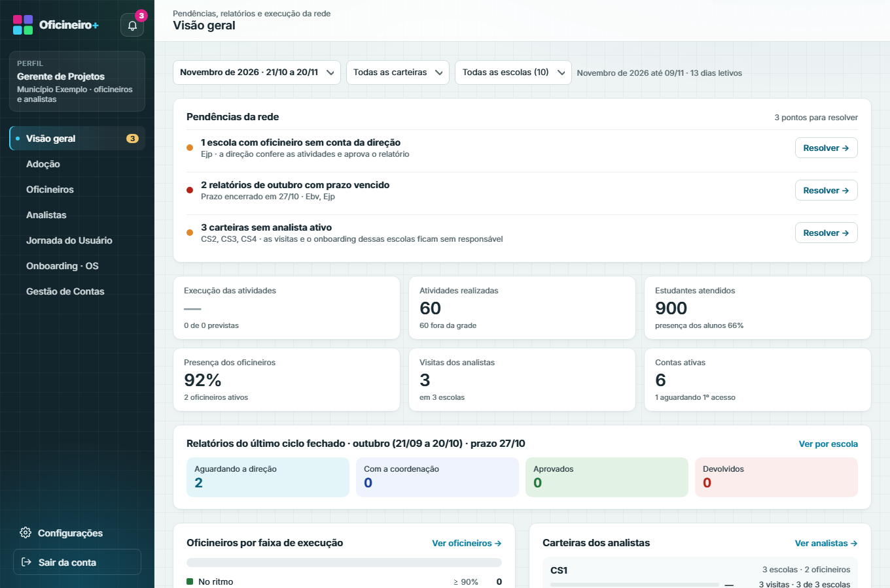
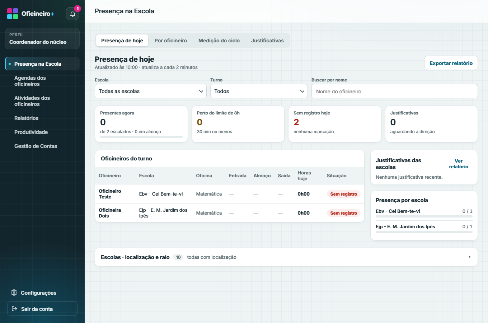
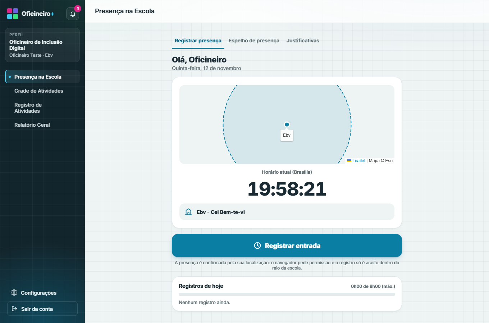
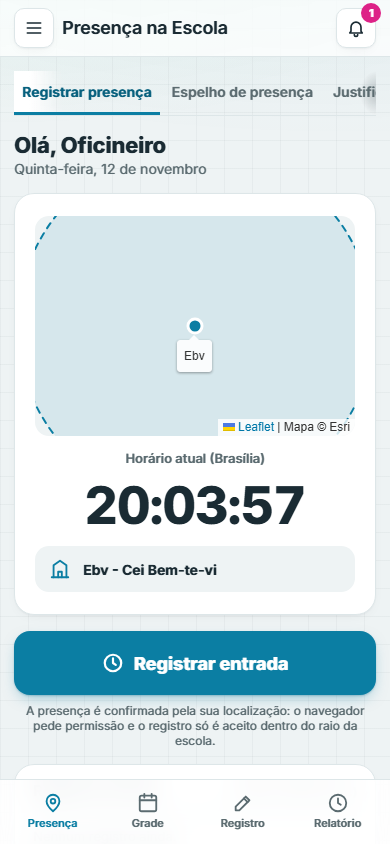
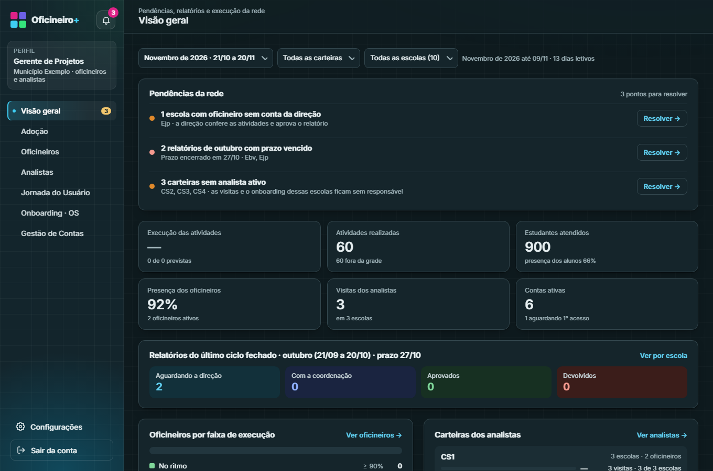
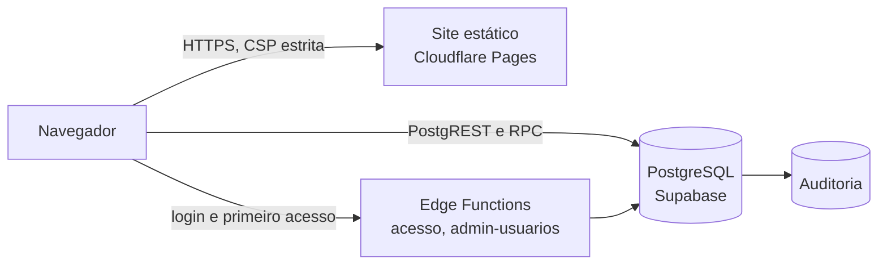

<p align="center">
  <picture>
    <source media="(prefers-color-scheme: dark)" srcset="public/brand/oficineiromais-logo-negativo-transparente.svg">
    
  </picture>
</p>

<p align="center">
  Gestão das oficinas de tecnologia educacional nas escolas da rede municipal.
</p>

<p align="center">
  <a href="https://github.com/Kamadoo/oficineiro-mais/actions/workflows/ci.yml"></a>
  
  
  
</p>

---

## Sobre

O Oficineiro+ acompanha o trabalho dos oficineiros que levam soluções de tecnologia educacional às escolas: presença na escola com conferência de localização, grade de aulas, registro de cada atividade, relatório mensal assinado, visitas de campo dos analistas e a gestão de contas e carteiras da rede.

Cada perfil vê apenas o que lhe cabe. As regras de acesso ficam no banco de dados, com Row Level Security em todas as tabelas, e cada operação sensível fica registrada em auditoria.

## In English

Oficineiro+ is a management system for the technology workshops that run in a city's public schools. Workshop instructors check in at school with location verification, keep a weekly timetable, log every class and sign a monthly report; school principals validate timetables and reports; field analysts plan and record school visits; managers and coordinators follow adoption, attendance and accounts across the network.

It is a static site backed by PostgreSQL on Supabase, with no application server: business and access rules live in the database as Row Level Security policies and SQL functions (59 migrations, 692 pgTAP assertions), and two Deno Edge Functions handle sign-in and account administration. The interface is written in declarative components rendered with React 18, served under a strict Content Security Policy. Continuous integration runs the database tests, an RLS audit, unit tests, a Playwright sweep of every screen with axe-core accessibility checks, and linting for JavaScript, Python and TypeScript. The code and documentation are in Portuguese, the language of the users.

## Perfis

| Perfil | Responsabilidades |
| --- | --- |
| **Oficineiro** | Marca entrada, almoço e saída na escola; monta a grade semanal; registra as aulas; assina o espelho de ponto e envia o relatório do ciclo. |
| **Direção escolar** | Confirma ou contesta as aulas, valida a grade e decide as justificativas de presença da própria escola. |
| **Analista** | Registra visitas às escolas da carteira, acompanha a agenda, a jornada de uso e o onboarding. |
| **Coordenação** | Acompanha presença, produtividade, relatórios e contas do núcleo. |
| **Gerência de projetos** | Visão da rede inteira, agenda dos analistas, adoção, onboarding e cadastro de contas. |
| **Administração** | Escolas, turmas, carteiras, feriados, correções excepcionais e auditoria completa. |

São 6 perfis e 54 telas, com modo escuro e layout responsivo até 360 px.

## Telas

As capturas abaixo usam apenas dados fictícios.

<p align="center">
  
</p>

<table>
  <tr>
    <td width="40%"></td>
    <td width="40%"></td>
    <td width="20%"></td>
  </tr>
  <tr>
    <td align="center">Presença de hoje (coordenação)</td>
    <td align="center">Registro de presença com raio da escola</td>
    <td align="center">Celular</td>
  </tr>
</table>

<p align="center">
  
</p>

## Arquitetura



- **Interface:** componentes declarativos (`.dc.html`) com modelo, estilo e lógica no mesmo arquivo, renderizados com React 18 por um runtime de componentes de terceiros. Cada perfil é um componente que compõe suas telas, o menu e o cabeçalho comuns.
- **Build:** `scripts/build.py` publica cada arquivo com hash no nome, calcula o hash do script inline para a CSP, confere o SHA-256 dos componentes de terceiros e interrompe a geração se encontrar dados pessoais.
- **Banco:** 57 migrações versionadas, funções privilegiadas isoladas no schema `privado` e expostas por invólucros em `public`, tarefas agendadas com `pg_cron`.
- **Funções de borda:** autenticação por usuário e senha, primeiro acesso por CPF ou CNPJ com código por e-mail e administração de contas, em TypeScript (Deno).

Detalhes em [docs/arquitetura.md](docs/arquitetura.md).

## Segurança

- Row Level Security em todas as tabelas; nenhuma permissão para visitantes.
- Autenticação em dois fatores (TOTP) obrigatória para todos os perfis.
- CPF e CNPJ cifrados no banco; as telas recebem apenas a forma mascarada, e a revelação é exclusiva da gerência e auditada.
- Presença conferida pela distância até a escola; as coordenadas não são armazenadas.
- CSP sem `unsafe-inline` para scripts, Subresource Integrity no React, HSTS, `frame-ancestors 'none'` e `Cross-Origin-Opener-Policy`.
- Tempo de resposta mínimo constante no login, contra enumeração de usuários.
- Auditoria de RLS, matriz de permissões das RPC por perfil e testes de escopo entre escolas e carteiras.

Detalhes em [docs/seguranca.md](docs/seguranca.md).

## Qualidade

- 692 asserções pgTAP cobrindo regras de negócio, permissões e fluxos de cada perfil (`supabase/tests`).
- Auditoria automática de RLS, matriz de permissões das RPC e testes de escopo, comparadas com o resultado esperado (`tests/security`).
- Testes unitários das bibliotecas com `node:test` (`tests/unit`) e das funções de borda com `deno test` (`supabase/functions/tests`).
- Varredura de todas as telas, abas e gavetas nos temas claro e escuro e no celular com Playwright e checagem de acessibilidade com axe-core (`tests/ui`).
- ESLint e Prettier em todo o JavaScript, inclusive o script de cada componente; Ruff nos scripts Python; `deno fmt`, `deno lint` e `deno check` nas funções de borda.
- Integração contínua no GitHub Actions com ações fixadas pelo commit e Dependabot.

Como rodar cada grupo em [docs/testes.md](docs/testes.md). Publicação, cópias de segurança e troca de chaves em [docs/operacao.md](docs/operacao.md).

## Estrutura

```
src/
  index.dc.html        página de entrada e autenticação
  components/          perfis, telas, menu e cabeçalho
  lib/                 autenticação, base comum, planilhas, notificações, aparência
  styles/              estilo comum com tema claro e escuro e estilo da página de entrada
public/                marca, ícones, manifesto, guia rápido e aviso de privacidade
vendor/                runtime de componentes, React, Leaflet e fonte Inter (terceiros, com hash conferido no build)
supabase/
  migrations/          esquema, políticas de acesso e funções
  functions/           Edge Functions
  tests/database/      testes pgTAP
  scripts/             verificação de segurança e promoção de administrador
scripts/               build, servidor local, lint dos componentes e verificação de dados pessoais
tests/
  security/            auditoria de RLS, matriz de RPC e testes de escopo
  unit/                testes unitários das bibliotecas
  ui/                  varredura das telas e acessibilidade
  fixtures/            dados fictícios para os testes
docs/                  arquitetura, segurança, testes e operação
```

## Executando localmente

Requisitos: Python 3.12+, Node.js 22+ e a [CLI do Supabase](https://supabase.com/docs/guides/cli).

```bash
supabase start
cp src/config.example.js src/config.js
npm install
npm run build
npm run serve
```

## Licença

Copyright (c) 2026 João Vitor Nunes. Todos os direitos reservados. Este repositório é público apenas para consulta; ver [LICENSE](LICENSE).
